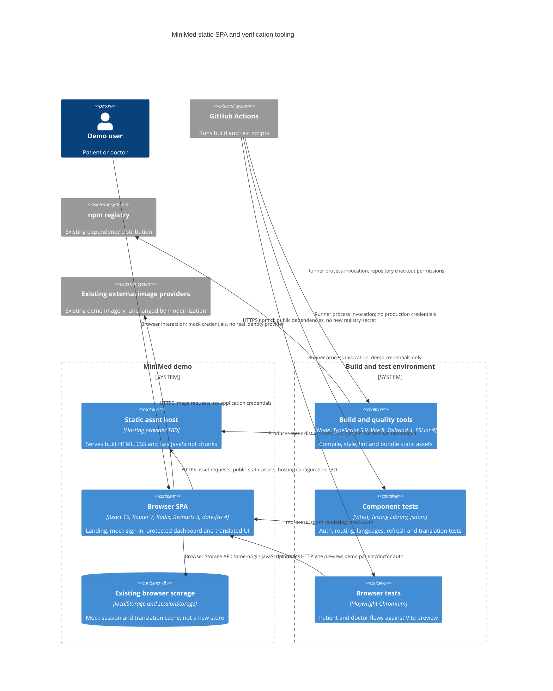

# 0001. Frontend stack modernization

- **Status:** Proposed
- **Date:** 2026-11-18
- **ARB ticket:** TO BE CREATED
- **Authors:** TBD — owner to confirm before ARB
- **Owning team:** TBD — owner to confirm before ARB
- **Related ADRs:** N/A — no existing ADRs in this repository.

## Context

MiniMed is a static SPA demo with mock glucose, insulin and device data, not a
clinical system. It has no backend. Preserve the landing, authentication and
protected dashboard routes, patient/doctor demo logins, language selection,
translation service, mock data, charts and translation-automation DOM contracts.
The React 18/Vite 5/Tailwind 3/ESLint 8/Router 6 baseline needs modernization,
focused dashboard components and automated regression coverage.

ARB triggers: T7 — major upgrades React 18→19, Vite 5→8, Tailwind 3→4,
ESLint 8→9 and React Router 6→7; adoption of Vitest and Playwright testing
frameworks. No new backend, deployed service, data store or auth/network boundary
is introduced. This draft requests review, not approval.

## Decision

We will modernize the existing SPA in place using React 19, Vite 8, strict
TypeScript 5.9 project references, Tailwind 4 CSS-first configuration and Vite
integration, ESLint 9 flat configuration with typescript-eslint 8, and Router 7.
We retain Radix UI, upgrade Recharts to 3 and date-fns to 4, use a blue palette,
split dashboard features and lazy-load routes. We adopt Vitest with Testing
Library/jsdom for unit/component tests and Playwright Chromium against production
preview for patient and doctor flows. GitHub Actions runs lint, typecheck, tests,
build and e2e. Locked dependencies determine supported Node versions.

## Alternatives considered

| Alternative | Pros | Cons | Why rejected |
| --- | --- | --- | --- |
| Do nothing | No migration effort or immediate regression risk | Retains older stack and lacks requested regression coverage | Does not meet modernization and test requirements |
| Incremental patch-only upgrades | Smaller individual diffs | Leaves requested major migrations incomplete; prolongs mixed tooling | Does not deliver the requested target stack in this change |
| Replace with a server-rendered full-stack framework | Could support future backend workflows | Adds runtime and deployment complexity to a mock static demo | No backend requirement justifies that architectural expansion |

## Architecture

## Non-functional requirements

| NFR | Target | How met |
| --- | --- | --- |
| Availability SLO | TBD — owner to confirm before ARB | Static hosting remains unchanged; hosting SLO unverified |
| p95 latency | TBD — owner to confirm before ARB | Lazy route chunks; no measured latency commitment |
| RPO / RTO | TBD — owner to confirm before ARB | Mock browser-local state; no backend recovery system |
| Peak load | TBD — owner to confirm before ARB | No capacity measurements supplied |
| Scaling model | TBD — owner to confirm before ARB | Static asset delivery; no application server introduced |
| Data retention | TBD — owner to confirm before ARB | Existing session/cache storage behavior retained; owner to define policy |

## Security & compliance

- **Data classification:** Mock demo data only; real patient data is outside scope. Formal classification TBD — owner to confirm before ARB.
- **Encryption at rest:** Browser storage is not application-encrypted. Hosting controls and KMS configuration TBD — owner to confirm before ARB.
- **Encryption in transit:** Existing external imagery uses HTTPS; production hosting TLS configuration TBD — owner to confirm before ARB. Local preview uses loopback HTTP.
- **AuthN / AuthZ:** Mock patient/doctor credentials and client-side protected routing only; not a production authorization boundary.
- **Secrets:** No new runtime secrets. Demo credentials are public and not production credentials.
- **Audit logging:** No clinical or transactional audit service; requirements TBD — owner to confirm before ARB.
- **Data residency / regions:** TBD — owner to confirm before ARB.
- **Policy sections satisfied:** No infrastructure resources or deployments are added. Approved-infrastructure policy resource controls are N/A for this frontend-only change; T7 review remains required.
- **Threats considered:** Dependency supply-chain risk, development-tool ReDoS advisory, script access to browser storage, accidental use with real medical data, and route/translation regressions. Mock auth must not be mistaken for secure clinical access.

## Cost

| Item | Assumption | Monthly estimate |
| --- | --- | --- |
| Static hosting and asset delivery | Existing deployment, provider and usage unverified | TBD — owner to confirm before ARB |
| CI runners and browser artifacts | Vitest and Playwright add CI work; usage unmeasured | TBD — owner to confirm before ARB |
| **Total** | No cost estimate or calculator inputs supplied; budget threshold cannot be evaluated | TBD — owner to confirm before ARB |

## Operations

- **On-call rotation:** TBD — owner to confirm before ARB.
- **Runbook:** README.md documents setup, scripts and demo credentials; incident ownership/runbook TBD — owner to confirm before ARB.
- **Dashboards / alarms:** No new observability service. Requirements TBD — owner to confirm before ARB.
- **Rollback plan:** Revert the modernization commits and redeploy the prior static build through the existing release mechanism. No backend schema migration.
- **Migration / cut-over plan:** Validate Node compatibility and lockfile install; run lint, typecheck, Vitest, production build and both Playwright demo flows; obtain ARB approval before merge; publish built assets with the existing release process. Release owner TBD — owner to confirm before ARB.

## Policy exceptions requested

| Rule | Resource | Justification | Compensating control | Expiry |
| --- | --- | --- | --- | --- |
| none | N/A — no new infrastructure | N/A — no exception requested | N/A — ARB approval is still required | N/A |

## Consequences

- Positive: Current frontend stack, localized loading state, smaller dashboard modules, explicit Node requirements and automated auth/language/dashboard regression checks.
- Negative / risks: Major-version behavioral and CSS changes require review. Browser tests add installation time and artifacts. Published dependency advisories may block security acceptance.
- Follow-ups: Create ARB ticket, assign owners, resolve dependency advisory, confirm missing NFR/cost/security details, and record review before merge.

## Open questions

- Who owns the SPA, release process, security review and on-call rotation? TBD — owner to confirm before ARB.
- What are availability, latency, RPO/RTO, peak load, scaling and retention requirements? TBD — owner to confirm before ARB.
- What hosting TLS, encryption-at-rest, region, residency and classification controls apply? TBD — owner to confirm before ARB.
- What CI/hosting usage, monthly budget and artifact-retention limits apply? TBD — owner to confirm before ARB.
- When will a patched picomatch be published, or what reviewed alternative should address GHSA-fc5q-39xc-vjpf without silently downgrading the requested stack?
- Who creates and approves the ARB ticket? TO BE CREATED.
